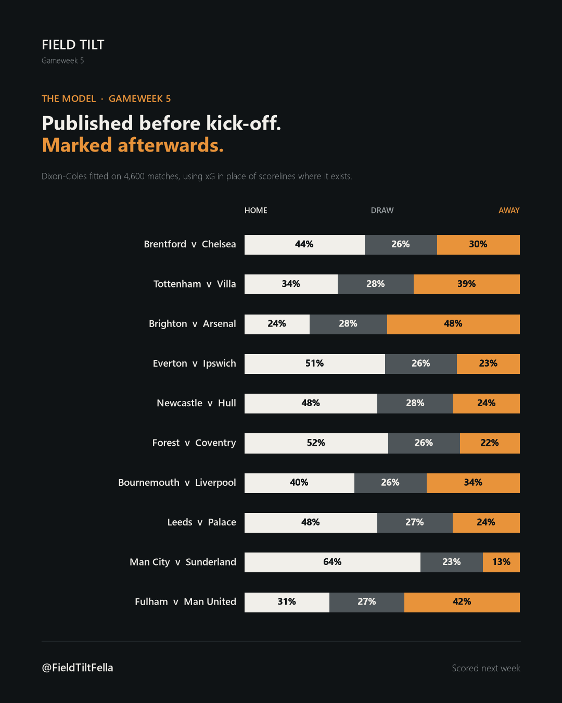

# PLsight

The data pipeline and models behind **[Field Tilt Fella](https://thefieldtiltfella.substack.com)**, my weekly
Substack on the Premier League. It's a PostgreSQL database that grows every gameweek, the SQL that turns it into
a post, and a match-prediction model whose forecasts are published before kick-off and scored afterwards.



## The idea

There's no fixed format. Each week I write about whatever caught my interest, or I take a claim from the week's
coverage and check whether the numbers back it up. The topic changes, so the pipeline is built to make
answering a new question cheap rather than to produce the same report each week.

It keeps a few things ready to use for whatever the post needs:

- **Match-level stats, split into layers** (see Methods), to show what actually happened in a game
- **Expected points**, showing what each side's performances were worth compared with the points they got
- **Predictions for the next gameweek**, published before kick-off and marked honestly afterwards
- **Twelve seasons of history**, to test whether something is really unusual or has happened before

## How I built this

This is an AI-assisted project, and I want to be clear about who does what.

- **My part:** I decide what each post investigates, whether that's an idea of my own or a claim from the
  week's coverage worth checking. I chose the data sources and the metrics, I collect the FotMob data each
  week, and I run the pipeline. I interpret the results and write every post.
- **The AI agent's part:** it wrote the code in this repository: the database, the loaders, the validation,
  the prediction model and the scoring. For each post, it also runs the statistical tests I ask for on these
  data files. That analysis happens in conversation with the agent rather than in scripts, so it isn't
  included here.
- **How I check it:** I question results that don't match what I've seen, and I state the caveats and sample
  sizes in the posts. In Gameweek 1, 101 fields turned out to be wrong because stats had been captured while
  matches were still being played. That led to the "capture the morning after" rule and three new validation
  checks in `import_gw.py`.

The pipeline lets me spend my time on choosing the questions and writing the posts. Next, I want to write
the weekly analysis myself as notebooks in this repository.

## Selected posts

- **[Gameweek 2: What repeats, and what doesn't.](https://substack.com/@thefieldtiltfella/note/p-214356397)** Correlated each team's numbers from week to week to see which
  stats reflect habit and which reflect luck. It uses the significance threshold for the sample size (r ≈ 0.44
  for 20 teams) rather than treating every correlation as meaningful. It also shows that possession barely
  predicts xG (+0.24), while penetration becomes a strong predictor once teams are compared at similar
  possession levels. The pooled figure was hiding the relationship.
- **[Gameweek 3: What actually stops goals.](https://substack.com/@thefieldtiltfella/note/p-215256444)** Tested 21 defensive measures against goals and xG conceded. The
  number of tackles and clearances tells you almost nothing. What the opposition manages (shots, box touches,
  shot distance) tells you almost everything. Interceptions turn out to be an attacking stat: +0.76 with a
  side's *own* xG. The post also explains the expected-points method step by step, and asks whether the
  table is lying.
- **[Gameweek 4: "Bad-shot disease".](https://substack.com/@thefieldtiltfella/note/p-215960018)** Tested another writer's claim about Manchester United. Excluding one
  outlier match, United take the most shots in the league, with a rising share from long range and 74% never
  reaching the keeper. Long-range shooting on its own isn't the problem, though: across the league, the share
  of shots from distance isn't significantly correlated with xG.


## Data

Two sources, used together on purpose:

- **[football-data.co.uk](https://www.football-data.co.uk/englandm.php):** loaded automatically. It covers results,
  shots, shots on target, corners and cards across twelve seasons of the Premier League, plus recent
  Championship seasons so promoted clubs have a history. This is the backbone, and it runs itself.
- **FotMob, transcribed by hand:** xG, xGOT, big chances, passing, duels and defensive actions (47 columns per
  team, defined in `fotmob_template.csv`), entered each gameweek. There's no free bulk xG source any more, so
  transcription is the honest route. Having two sources also means each checks the other: the importer
  compares shots and shots on target against football-data.co.uk and flags any disagreement.

## Methods

**Three-layer goal decomposition.** xG, xGOT (expected goals on target) and goals split a result into:

| Layer | Measures |
|---|---|
| xG | Quality of chances created |
| xGOT − xG | How well the shots were struck |
| Goals − xGOT | Whether the keeper was beaten |

This separates chance creation, finishing and goalkeeping, which most coverage lumps together as "they were
unlucky".

**Expected points (`xpts.py`).** Each side's xG is treated as the average of a Poisson distribution. Combining
the two gives the probability of every scoreline, and therefore of a win, draw or loss. Expected points =
3 × P(win) + 1 × P(draw). The file's docstring sets out the assumptions and how they bias the result.

**Match prediction (`predict.py`).** A Dixon-Coles Poisson model fitted on roughly 4,600 matches:

- an attack and a defence rating for each team, plus home advantage
- a correction for low scores, because plain Poisson gets 0-0, 1-0 and 1-1 wrong
- recent matches weighted more heavily (they count half after 180 days)
- an L2 (ridge) penalty, so early-season ratings don't swing wildly on a few games
- xG used in place of goals wherever it exists, so the ratings settle faster

**Honest evaluation (`track.py`).** Predictions are saved before kick-off and never edited. They're scored with
proper scoring rules (Brier score and log loss) and always compared with a naive baseline using long-run
Premier League home/draw/away rates. A model that can't beat the baseline isn't adding anything.

## Repository layout

| File | What it does |
|---|---|
| `setup.sql` | Creates the database: tables and views. Run once on an empty database. |
| `migrate.sql`, `migrate_columns.sql` | Schema changes applied after the first release |
| `queries.sql` | The analysis queries behind each post (see below) |
| `ingest.py` | Loads football-data.co.uk, retrying if the site limits requests |
| `import_gw.py` | Validates and loads a gameweek of FotMob stats |
| `teams.py` | Standard team names and the map from alternative names |
| `predict.py` | Dixon-Coles model: fit, predict, backtest, chart |
| `track.py` | Scores the published predictions against results |
| `xpts.py` | Expected-points table and chart |
| `check_db.py` | Quick check of what's loaded |
| `fotmob_template.csv`, `fixtures_template.csv` | Input formats |
| `gwXX_stats.csv`, `gwXX_fixtures.csv` | Each gameweek's transcribed stats and fixtures |
| `preds/` | Predictions saved before kick-off, plus charts |

### The queries

- **A1 Match card:** every fixture in a gameweek, split into the three layers
- **A2 How they played:** directness, territory, a pressing index and a defensive-line proxy
- **B1 The table:** points alongside xG, xG conceded and over- or under-performance
- **B2 The three layers:** where each team's goal difference actually comes from
- **C1 Rolling form:** xG difference over the last six matches
- **C2 Movers:** the biggest changes from one week to the next
- **C3 Style drift:** the last six matches against the first six, on directness and pressing
- **C4 Historical context:** shot dominance at the same point of the season, across twelve seasons

## Setup

Requires Python 3.10+ and PostgreSQL.

```bash
# 1. Create a database called PLsight, then run setup.sql against it

# 2. Python environment
python -m venv .venv
.venv\Scripts\activate            # Windows  (source .venv/bin/activate on macOS/Linux)
pip install -r requirements.txt

# 3. Credentials: copy the example and fill in your password
copy .env.example .env            # cp on macOS/Linux
```

`.env` is gitignored. No credentials are stored in the code.

### Backfill history

```bash
python ingest.py --seasons 2014-15 2015-16 2016-17 2017-18 2018-19 2019-20 2020-21 2021-22 2022-23 2023-24 2024-25 2025-26
python ingest.py --seasons 2023-24 2024-25 2025-26 --division E1     # Championship, for promoted clubs
```

## The weekly loop

```bash
python ingest.py --seasons 2026-27                         # results + cross-check source
python import_gw.py gw05_stats.csv --dry-run               # validate, write nothing
python import_gw.py gw05_stats.csv                         # load
python xpts.py --chart preds/xpts_gw05.png                 # expected-points table
python predict.py --fixtures gw06_fixtures.csv --gw 6 --out preds/gw06_pred.csv --chart preds/gw06_pred.png
python track.py --score                                    # mark everything so far
```

**Capture stats the morning after, never on the day.** Providers keep revising counting stats for hours after
the final whistle. Every error in Gameweek 1 came from matches captured while others were still being played.

## Limitations

- **Small samples.** xG needs about six matches to mean much, so early-season posts build the picture rather
  than draw conclusions.
- **Transcription is the main risk.** The validator catches contradictions inside the data and checks against
  football-data.co.uk. It can't catch a number that is wrong but plausible.
- **`press_index` is an approximation of PPDA** (passes allowed per defensive action), not the real thing. It
  counts opponent passes per tackle and interception across the whole pitch.
- **Gameweeks are worked out from match dates, not taken from a source,** so postponements can shift the
  numbering.
- **Expected points treats the two teams' scoring as independent** and Poisson-distributed around match xG.
  Both assumptions understate draws (see `xpts.py`).

## Credits

Results and match statistics from [football-data.co.uk](https://www.football-data.co.uk). Advanced metrics from
FotMob. Analysis and writing by Samuel Halpin, published as [@FieldTiltFella](https://thefieldtiltfella.substack.com).
